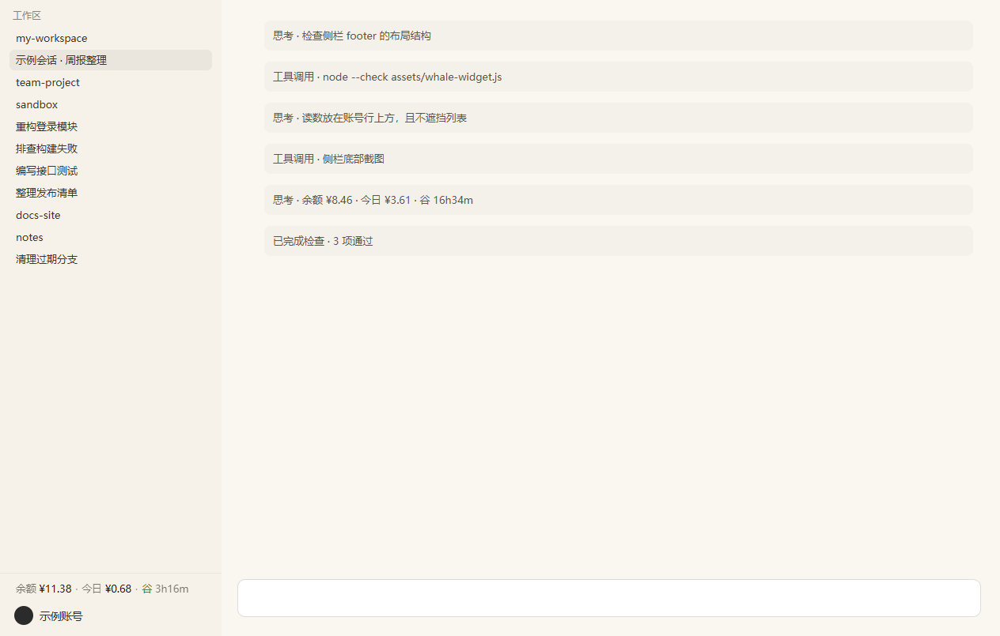

# dsh-balance-plain —— DSH 侧栏余额纯文本读数

> 一句话：把 DeepSeek 余额、今日消耗、峰谷倒计时、每轮消耗和余额预警，做成侧栏 footer 里的一行纯文本——**真正嵌进侧栏**，不浮、不挡、不弹。



**English summary** — A text-only DeepSeek balance readout embedded in the DSH sidebar footer: balance, today's spend, peak/off-peak countdown, per-turn cost and a low-balance alert. No mascot, no press/drag animations, no sound, no menus; the whole layer is `pointer-events: none`. MIT licensed.

MIT License（见 [LICENSE](LICENSE)）· 来源说明见 [PROVENANCE.md](PROVENANCE.md)

---

## 长什么样

**侧栏常驻**（左侧栏最下方、「工作区」列表下面、用户名上方）——它是侧栏 footer 里的**一行原生内容**：

```
team-project
  · 整理发布清单
docs-site
────────────────────────   ← footer 自带的上分隔线
余额 ¥8.46 · 今日 ¥3.61 · 谷 16h34m
示例账号（账号行）
```

这行是**真正插进侧栏 DOM** 的：作为账号行所在那块（`settings-area`）的第一个子节点，
页面自己有 `footer(flex:0 0 auto) + 列表区(flex:1 1 0%)` 的布局，所以这行长高会自动挤占列表区，
**不覆盖任何内容、不钉在屏幕坐标上**；侧栏收起时随 footer 一起消失。

视觉上无背景板、无边框、无阴影、无图标，文字颜色继承侧栏（深浅主题自动跟随），
整层 `pointer-events: none`，点不动也不挡点击。

**点开左下角账户菜单时**：侧栏那行临时收起，改成菜单里的一行（克隆原生菜单行，继承菜单字体/行距/配色），
插在「账户用量，点击刷新」正上方。

> 为什么能做到「真嵌入」：这个侧栏的 footer 被 `dsh-claude-style` 主题接管，主题会把 footer 里
> **不认识的直接子节点**标成 `data-dsh-claude-footer-hidden` 并 `display:none!important`。
> 所以插入位置选在主题认识的 `settings-area` **内部**——既不会被主题吞掉，又能吃到 footer 的自动布局。
> 主题未启用时退回按 class（`footArea` / `sidebarCol`）定位。

## 保留的功能

| 功能 | 说明 |
|---|---|
| 余额 | 请求 `https://api.deepseek.com/user/balance`，**10 秒刷新**（每轮对话结束再补刷一次；连续失败 3 次自动退到 60 秒；每次请求带 `refresh=1` 绕过服务端 25 秒缓存）；API key 优先，没有则走 DSH 账号登录态 |
| 今日已用 | 用余额观测账本（`.dshw-usage.json`）累计，充值/赠金单独记账不冲抵消费。10 秒观测一次 |
| 峰谷标识 | 工作日 9–12、14–18 为峰，其余为谷；周末全天谷价；后面跟下一个切换点倒计时 |
| 每轮消耗 | 按上一轮真实 usage 与峰谷价换算，一轮结束在余额行上方显示一小行纯文字 |
| 余额预警 | 低于阈值提醒一次，余额回到阈值以上后重新武装 |

阈值/开关在设置文件里（`.dshw-usage.json` 的 `settings.alert.below`；
`.dshw-size.json` 的 `turnCostOn` / `turnCostCloseMs`）。

## 去掉的东西

鲸鱼角色图、按压 Q 弹、拖拽吸附与镜像翻转、点击泡泡队列、泡泡编辑器、
音效与音效组、角色/图片/音频管理、主菜单及其所有子面板、**任何鼠标与触摸事件**。

整层容器 `pointer-events: none` —— 它点不动，也不会挡住页面上的任何点击。
本仓库不含任何鲸鱼图片或音效。

## 安装

**Web profile（推荐）**

```sh
dsh plugin --profile web add https://github.com/zeenhuang9-boop/dsh-balance-plain
```

⚠️ **不要和 `dsh-whale-widget` 同时安装**：两者注册同一组 `/dsh-whale/*` 路由、读写同一个账本文件，也会同时注入前端脚本。
如果之前装过，先卸掉：

```sh
dsh plugin --profile web remove dsh-whale-widget
```

**桌面端（Electron）**

桌面端 profile 由 Electron 独占，`dsh plugin --profile desktop` 会被 CLI 拒绝；桌面端的安装以 DSH 自己的
插件管理方式为准（本仓库未在桌面端验证过一键安装流程）。重载界面：点标题栏右上角 ⟳ 或按 Ctrl+R。

> 无论哪种安装方式，数据都写在 `~/.dsh/.dshw-*.json`。

## 已知限制

- **依赖侧栏 footer 的 DOM 结构**：读数插在 footer 里账号行所在的那一块（`settings-area`）。
  `dsh-claude-style` 主题开启时用 `data-dsh-claude-part~="settings-area"` 定位；主题关闭时退回按 class 定位。
  若 DSH 大改侧栏结构，需要重新适配。
- 账户菜单行靠 `[role=button]` + 文案「账户用量」+ 尺寸 + 左下角位置四重判定；
  DSH 大版本改了账户菜单结构时会退化成「只有侧栏常驻」，不会报错。
- 账户菜单是否打开**不能**用 `aria-expanded` 判：侧栏其它可展开行也带这个属性，会误定位。
- **不能**用全文档 XPath 按「账户用量」找菜单行：聊天正文里也会出现这几个字，会误判。
- 找不到侧栏 footer 时这行**不显示**（不回退到浮动层）。
- 服务端 `lib/` 提供 `/dsh-whale/*` 路由与账本读写；前端只消费其中 4 条路由，数据文件格式不变。
- 只在 Windows 11 + DSH 桌面版实测过；macOS / Linux 未验证。

## 目录

```
lib/index.js            # 服务端（余额/账本/峰谷/路由）
lib/accounting.mjs      # 记账模块
assets/whale-widget.js  # 新前端：纯文本读数，真嵌入侧栏 footer
assets/screenshot-1.png # 预览台截图（市场卡片用）
icon.png                # 自制插件图标
cordis.patch.yml        # bundle 挂载声明
screenshots.json        # 市场截图声明（指向 assets/screenshot-*.png）
tools/preview.html      # 离线预览台：桩掉 fetch，按真实侧栏结构渲染
PROVENANCE.md           # 来源与许可
```

## 离线预览台（开发用）

浏览器直接打开 `tools/preview.html`：`?s=normal|alert|peak|error` 切场景，`&turn=1` 模拟一轮结束，
`&dark=1` 深色背景，`&collapse=1` 模拟侧栏收起。页面暴露 `window.__snapNow()` 返回 JSON 快照
（是否嵌在 settings-area 内、各块坐标、提示文字、是否还有浮动层、图片/音频数量、pointer-events）。

## 来源与许可

本项目按 MIT 发布（见 [LICENSE](LICENSE)）；前端、图标与截图均为本项目原创，仓库内不含第三方美术素材。
详见 [PROVENANCE.md](PROVENANCE.md)。
